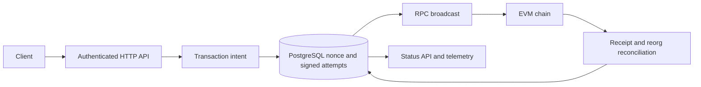

# Transaction Orchestrator

Transaction Orchestrator submits EVM transactions for an application without losing track of them when an RPC call or process fails.

A broadcast can succeed even when the RPC response disappears. Retrying blindly can spend a second nonce or duplicate a business operation; waiting forever can leave the operation stuck. This Go service persists the intended operation, its nonce, and the exact signed attempts in PostgreSQL before broadcast. It can then reconcile a known transaction hash, replace a pending attempt with a bounded fee bump, and revise its result if the chain reorganizes.

## Transaction lifecycle



One transaction intent represents one business operation. PostgreSQL reserves its signer nonce and stores immutable signed EIP-1559 bytes before submission. Replacement attempts keep the same intent, signer, nonce, destination, value, calldata, and gas limit; only bounded fee fields change. A canonical receipt selects a provisional winner, and the configured confirmation depth determines when it is reported confirmed.

## Engineering focus

| Problem | Design and resulting behavior |
| --- | --- |
| A client repeats a business request. | Tenant-scoped idempotency ties the request to one persisted intent; retry cannot allocate an unrelated operation. |
| Two workers contend for a signer nonce. | PostgreSQL owns nonce reservation transactionally, avoiding two local intents with the same reserved nonce. |
| The RPC accepts a transaction but drops its response. | The signed bytes and hash already exist locally; reconciliation uses that exact attempt after restart instead of allocating a new nonce. |
| A transaction remains pending. | A replacement retains immutable business fields and nonce, with bounded EIP-1559 fee increases. |
| A receipt is later orphaned. | Canonical receipt tracking can withdraw the provisional winner and recompute confirmation after a shallow reorg. |
| A provider is unavailable or inconsistent. | Eligible RPC endpoints are checked before use; multiple providers improve visibility but are not treated as consensus. |

The [failure matrix](docs/failure-matrix.md), [persistence model](docs/persistence.md), and [architecture](docs/architecture.md) describe the exact transitions.

## Quick start

Install Go 1.27.2, PostgreSQL 18 server tools (`initdb`, `pg_ctl`, `psql`), Python 3 with venv/pip, and Foundry Anvil 1.8.5. The demo uses disposable local services and accounts.

```sh
git clone https://github.com/lenoir-dev/Transaction-Orchestrator.git Transaction-Orchestrator
cd Transaction-Orchestrator
go mod download
make demo
go test ./...
```

The demo runs migrations, starts PostgreSQL and Anvil, drops a broadcast response after acceptance, restarts the service, recovers the known hash, signs a same-nonce replacement, confirms it, then forks out its receipt and re-includes the original attempt. It checks a final ledger checksum and writes `artifacts/demo-result.json`. See [demo steps](docs/demo.md).

The full local gate is `make verify-release`. It runs Go tests and race/fuzz checks, PostgreSQL and Anvil integration, demo and benchmark validation, Docker build, dependency and secret scans, SBOM generation, and a clean-clone replay. The [release guide](docs/release.md) describes generated evidence and the separate hosted CI step after publication. `make build` embeds a source-tree checksum in the binary; a plain `go build` reports source identity as unavailable.

## Local benchmark

`make benchmark-smoke` runs three correctness-gated measurements over a local fixture of 12 intents and two signers. The workload includes normal broadcasts, lost responses, and replacements. It writes raw runs and a median to `artifacts/benchmark-runs.json`; see the [methodology](docs/benchmark.md). The numbers describe this fixture only, not production throughput.

## Repository map

```text
cmd/txorch/      service entry point
internal/        intent lifecycle, signing boundary, RPC, reconciliation
migrations/      PostgreSQL schema
scripts/         demo, tests, release checks, source identity
api/             OpenAPI contract
docs/            architecture, operations, evidence, and ADRs
```

The [API contract](api/openapi.yaml), [test map](docs/evidence.md), [observability guide](docs/observability.md), [threat model](docs/threat-model.md), and [ADRs](docs/adr/) provide deeper detail. [Third-party notices](THIRD_PARTY_NOTICES.txt) cover the release binary.

## Scope and trust

The included HTTP server uses configured tenant bearer tokens and an explicitly enabled local development signer. Production key custody, authentication infrastructure, and deployment policy are external. A confirmed transaction has reached a configured observation depth, not irreversible finality. No RPC pool proves global mempool absence, and external transactions using the same signer remain a nonce ownership risk. Deeper reorgs pause affected work for operator review. The project has no production operating history or independent audit.

Apache-2.0. See [LICENSE](LICENSE).
